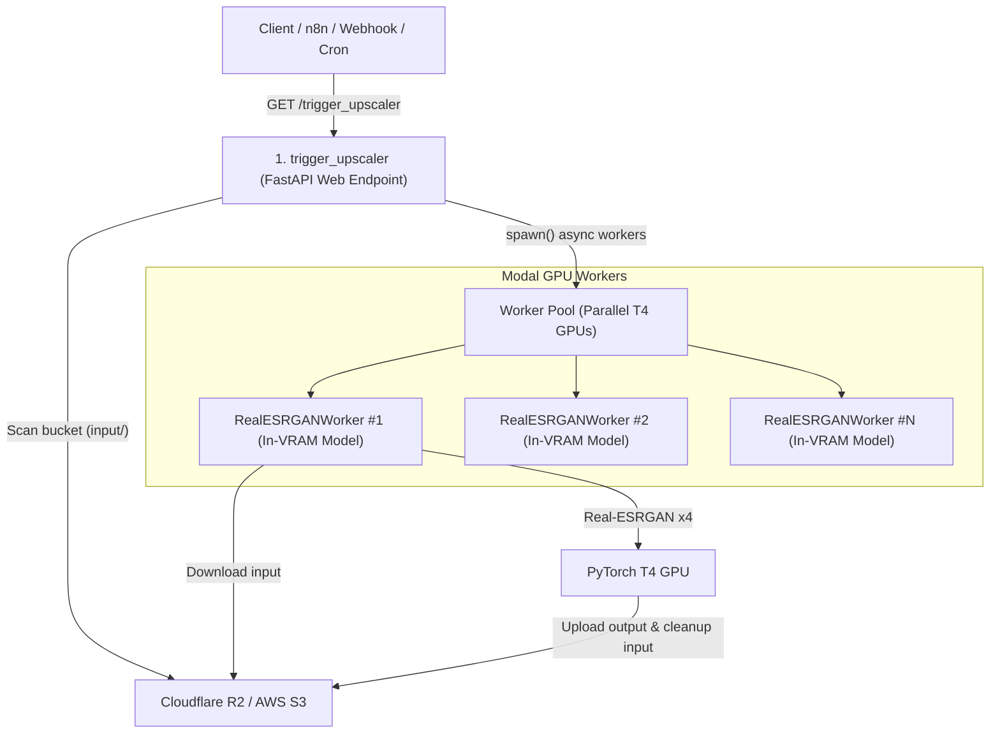

# Modal Image Upscaler (Real-ESRGAN x4plus)

A serverless, GPU-accelerated batch image upscaler deployed on [Modal](https://modal.com) using Cloudflare R2 / AWS S3 storage and official Modal Secrets.

Inspired by and upgraded from `runway-hackathon-batch-img-gen-and-upscaler`.

---

## Architecture & Workflow



### Key Highlights
1. **Official Built-in Modal Secrets**: Sensitive R2/S3 credentials are managed securely via `modal.Secret.from_name("r2-credentials")` without hardcoding.
2. **Dual-Container Optimization**:
   - `trigger_upscaler` runs on a minimal, ultra-fast CPU image for instantaneous web endpoint responses.
   - `RealESRGANWorker` runs on a CUDA-accelerated container with PyTorch and `RealESRGAN_x4plus` model pre-loaded into GPU VRAM using `@modal.enter()` and `scaledown_window=60`.
3. **In-Memory GPU Inference (`modal.Cls`)**:
   - Model weights are resident in GPU VRAM (FP16 half-precision), eliminating subprocess spawn overhead and re-initialization delays per task.
   - `trigger_upscaler`: Web endpoint (FastAPI) that scans the input folder (or handles a targeted image) and immediately dispatches workers asynchronously using `.spawn()`.
   - `RealESRGANWorker.upscale_image`: Dedicated T4 GPU worker that processes an image directly in-memory, writes to the output folder, deletes the source file, and frees disk space.

---

## 1. Setup & Modal Secret Creation

### Prerequisites
- Install Modal CLI:
  ```bash
  pip install modal
  ```
- Authenticate with your Modal account:
  ```bash
  modal setup
  ```

### Create the Modal Secret
Create the `r2-credentials` secret using the official Modal CLI:

```bash
modal secret create r2-credentials \
  R2_ENDPOINT_URL="https://<YOUR_ACCOUNT_ID>.r2.cloudflarestorage.com" \
  AWS_ACCESS_KEY_ID="<YOUR_R2_OR_AWS_ACCESS_KEY>" \
  AWS_SECRET_ACCESS_KEY="<YOUR_R2_OR_AWS_SECRET_KEY>" \
  BUCKET_NAME="playground" \
  INPUT_PREFIX="input/" \
  OUTPUT_PREFIX="output/"
```

*(Alternatively, copy `.env.example` to `.env`, populate your keys, and run `modal secret create r2-credentials --from-dotenv .env`)*

---

## 2. Running & Testing

### Option A: Test locally from the CLI
You can test the entire pipeline directly without deploying:

```bash
# Scan and process all images currently in input/
modal run modal_image_upscaler.py

# Or target a single specific image in the bucket
modal run modal_image_upscaler.py --filename "banner.png"
```

### Option B: Ephemeral Development Server (`modal serve`)
Start a live dev server with auto-reloading:

```bash
modal serve modal_image_upscaler.py
```
Modal will output a temporary endpoint URL, e.g.:
`https://<your-username>--modal-image-upscaler-trigger-upscaler-dev.modal.run`

---

## 3. Deploying to Production

Deploy the application persistently to Modal cloud:

```bash
modal deploy modal_image_upscaler.py
```

Modal will print your permanent production web endpoint URL:
`https://<your-username>--modal-image-upscaler-trigger-upscaler.modal.run`

---

## 4. Web Endpoint Usage & Parameters

The trigger endpoint exposes a `GET` interface that can be called from browsers, `curl`, Postman, n8n, GitHub Actions, or cron jobs.

### A. Batch Scan Mode (Default)
Scans `input/` in your bucket and spawns a worker for every found image:
```bash
curl "https://<your-username>--modal-image-upscaler-trigger-upscaler.modal.run"
```

Response:
```json
{
  "status": "success",
  "targets_acquired": 3,
  "files": ["img_01.png", "img_02.jpg", "img_03.webp"],
  "bucket": "playground",
  "input_prefix": "input/",
  "output_prefix": "output/"
}
```

### B. Single File Target Mode
Upscale only a specific file:
```bash
curl "https://<your-username>--modal-image-upscaler-trigger-upscaler.modal.run?filename=sample.jpg"
```

### C. Advanced Query Parameters
| Parameter | Type | Default | Description |
| :--- | :--- | :--- | :--- |
| `filename` | `string` | `null` | Optional file name to upscale specifically. |
| `prefix` | `string` | `input/` | Custom input prefix/folder to scan. |
| `delete_input` | `boolean` | `true` | Whether to delete the input image after successful upscale. |
| `tile_size` | `integer` | `0` | Tile size for splitting large images (e.g. `400` to prevent GPU memory errors on huge inputs). `0` = no tiling. |

Example with options:
```bash
curl "https://<your-username>--modal-image-upscaler-trigger-upscaler.modal.run?filename=heavy.png&tile_size=400&delete_input=false"
```
